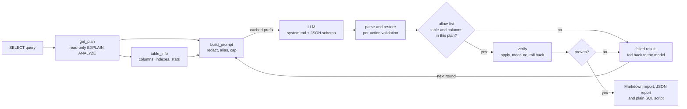

# Architecture

pgsage has one idea: **the model proposes, Postgres proves.** The LLM never decides whether
something is good; it only suggests, and a measurement on the real database decides.



## The proof

`verify._experiment` is the heart. For one proposal it runs two transactions on one connection:

1. **Baseline.** `SET LOCAL` timeouts, optional `ANALYZE` (statistics only), then
   `SET TRANSACTION READ ONLY`, then the query three times; the fastest run is kept. Roll back.
2. **After.** Timeouts, apply the change (`CREATE INDEX` or `CREATE STATISTICS` + `ANALYZE`), then
   `SET TRANSACTION READ ONLY`, measure three times. Roll back. For an index, the "new index"
   set includes the index's partition children, so an index on a partitioned parent is
   recognised when the plan uses a child index.

Rewrites need no DDL, so `verify_rewrite` runs in one read-only transaction: it checks
equivalence first (and stops there if it fails), then measures the original and the rewrite
**interleaved** (A, B, A, B, A, B) so drift and warm-up affect both equally.

Every statement that carries model- or caller-influenced text is executed with the extended
protocol (`run_single`, `prepare=True`), so PostgreSQL itself refuses a second statement. The
lexer-based gate is a second layer, not the only one.

`VerifyResult.improved` is true only if there is no error, the result is equivalent (or not
applicable), the new index is used (indexes), and the change is at least 1.1x **and** 0.5 ms
faster (or the plan cost drops when no timings exist). The absolute floor keeps a microsecond
query that "improves" by 18x from being called a win.

Rewrites are compared on column names, types and numeric precision, then on rows as text
(`EXCEPT ALL` both ways, or an ordered hash when the query has a top-level `ORDER BY`; an
`ORDER BY` inside a window function does not count). Volatile functions, `LIMIT` without a
top-level `ORDER BY`, and a rewrite identical to the original are never provable.

## The trust boundary

```text
 database ──(untrusted)──► sanitize ──► prompt ──► LLM ──(untrusted)──► validate ──► database
   names, values, text      alias, redact,        bounded JSON,        allow-list,
                            cap, delimit          per-action parse     re-validate, read-only
```

Data crosses the boundary twice and is treated as hostile both times. See `docs/security.md`.

## Modules

| Module | Responsibility |
| --- | --- |
| `plan.py` | Pydantic model of `EXPLAIN` JSON; `self_time` accounts for loops and parallel workers; `plan_digest` gives the model the derived numbers it computes badly |
| `sqlscan.py` | Lexer used by the safety gate, redaction and aliasing. The single place that knows SQL lexical structure |
| `verify.py` | `ensure_read_only`, `IndexSuggestion` / `StatsSuggestion`, `verify_index`, `verify_statistics`, `verify_rewrite`, and the equivalence check |
| `context.py` | Read-only lookups: `get_plan`, `table_info`, `top_queries` |
| `ai.py` | `Redaction` (literal tokens and name aliases), `build_prompt` (stable and volatile parts), `parse_explanation`, `explain_plan`, and the `AnthropicClient` / `OpenAICompatibleClient` |
| `prompts/system.md` | The system prompt; `prompts/__init__.py` loads it |
| `schema.py` | The JSON schema used for structured output |
| `tune.py` | Rounds, allow-list, attempt feedback; one `VerifiedChange` per proposal |
| `report.py` | Tool-neutral output for a `TuneReport`: a Markdown report for people, a versioned JSON report for tools, and a plain, idempotent SQL script of the proven DDL. Files are timestamped and never overwrite an earlier run |
| `evals.py` | Cases with known fixes, isolated per-case schemas, an oracle client |
| `cli.py`, `mcp_server.py` | Front ends; no logic of their own beyond wiring and printing |

## Prompt layout and caching

The prompt is built to stay small as queries grow. The data block is compact JSON (indentation
costs more the deeper a plan nests: a 100-join left-deep plan was about 240,000 tokens indented
and is about 8,000 compact and pruned). The query is whitespace-normalized after literals are
tokenized, so that cannot change a literal. A plan over `MAX_PLAN_NODES` (60) nodes sends the
full `digest` (capped at `MAX_DIGEST_ROWS`, keeping the most expensive rows) and the full detail
of the `HOTSPOT_NODES` (8) costliest nodes instead of the raw tree. A query over
`MAX_QUERY_CHARS` (100,000) is refused rather than truncated.

The request is ordered from most to least stable, so the provider can reuse its cache:

1. `system.md` (static; a cache breakpoint)
2. per-session boundary token, then the plan, digest, query and table metadata (a cache breakpoint)
3. `previous_attempts` and the closing reminder (not cached; changes every round)

The boundary token lives in `Redaction.nonce`, so it stays identical across rounds of one `tune`
call. A test (`test_cache_prefix_is_byte_identical_across_rounds`) guards this.

## Why these choices

- **Structured output** (`output_config.format`) so the reply is always parseable; parsing is still
  lenient and per-action, because the model can be refused or cut off.
- **A digest next to the raw plan**: self time with loops, and estimate error, are derived values
  models get wrong when asked to compute them from per-loop numbers.
- **Aliasing instead of dropping names**: the model needs table and column names to propose an
  index, so plain names stay readable and only unusual ones are tokenized and restored locally.
- **Best of three** measurements, a 1.1x and 0.5 ms threshold and an unused-index check: a single
  timing of a small query is noise, and an index the planner ignores is not a fix.
- **Parallel plans**: `self_ms` divides a node's combined worker time by the number of
  participating processes (`Workers Launched` + 1), so the digest points at the real bottleneck
  instead of a node whose per-loop time looks tiny.
