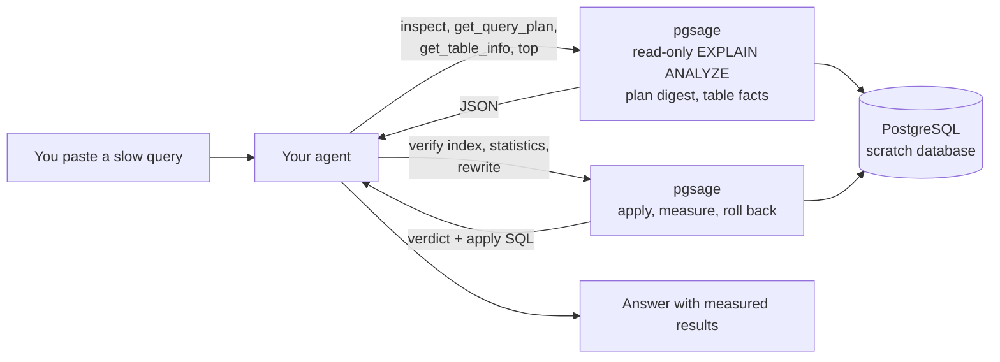

# Architecture

pgsage has one idea: **the agent proposes, Postgres proves.** The agent never decides whether
something is good; a measurement on the real database decides. pgsage contains no model: it is the
measuring half of a loop whose reasoning half is your AI coding agent.

The agent reaches pgsage in one of two ways, both backed by the same functions: the `pgsage`
command line (every command prints JSON) or the MCP server (`pgsage-mcp`). A skill
(`src/pgsage/skill/SKILL.md`, installed with `pgsage install-skill`) tells the agent when to use
them and carries the tuning guide.

## The proof

`verify._experiment` is the heart. For one proposal it runs two transactions on one connection:

1. **Baseline.** `SET LOCAL` timeouts, optional `ANALYZE` (statistics only), then
   `SET TRANSACTION READ ONLY`, then the query three times; the fastest run is kept. Roll back.
2. **After.** Timeouts, apply the change (`CREATE INDEX` or `CREATE STATISTICS` + `ANALYZE`), then
   `SET TRANSACTION READ ONLY`, measure three times. Roll back. For an index, the "new index"
   set includes the index's partition children, so an index on a partitioned parent is
   recognised when the plan uses a child index.

Rewrites need no DDL, so `verify_rewrite` runs in one read-only transaction: it checks
equivalence first (and stops there if it fails), then measures the original and the rewrite
**interleaved** (A, B, A, B, A, B) so drift and warm-up affect both equally.

Every statement that carries caller-influenced text is executed with the extended protocol
(`run_single`, `prepare=True`), so PostgreSQL itself refuses a second statement. The lexer-based
gate (`ensure_read_only`) is a second layer, not the only one.

`VerifyResult.improved` is true only if there is no error, the result is equivalent (or not
applicable), the new index is used (indexes), and the change is at least 1.1x **and** 0.5 ms
faster. A statistics proof also needs a changed plan (`node_types`). The absolute floor keeps a microsecond
query that "improves" by 18x from being called a win.

Rewrites are compared on column names, types and numeric precision, then on rows as text
(`EXCEPT ALL` both ways, or an ordered hash when the query has a top-level `ORDER BY`; an
`ORDER BY` inside a window function does not count). Volatile functions, `LIMIT` without a
top-level `ORDER BY`, and a rewrite identical to the original are never provable.

For a proven index or statistics change, `VerifyResult.apply` holds idempotent SQL: `IF NOT
EXISTS`, indexes built `CONCURRENTLY` (which must run outside a transaction block), and an
`ANALYZE` after statistics. Rewrites have no `apply`: they belong in application code.

## Data flow of `inspect`

`get_plan` runs `EXPLAIN (ANALYZE, BUFFERS, VERBOSE, FORMAT JSON)` in a read-only transaction with
timeouts, after the SQL gate has accepted the statement. `plan_digest` derives one row per node
(`self_ms` with loops and parallel workers accounted for, `estimate_off_by`,
`rows_removed_by_filter`) because those are numbers an agent gets wrong when it computes them from
per-loop timings. `tables_in_plan` finds the relations the plan touches, `table_ancestors` adds
partition parents, and `table_info` reads columns, indexes, size and `pg_stats`.

## Modules

| Module | Responsibility |
| --- | --- |
| `plan.py` | Pydantic model of `EXPLAIN` JSON; `self_time` accounts for loops and parallel workers; `plan_digest` derives the numbers an agent computes badly |
| `sqlscan.py` | Lexer used by the safety gate. The single place that knows SQL lexical structure |
| `verify.py` | `ensure_read_only`, `IndexSuggestion` / `StatsSuggestion`, `verify_index`, `verify_statistics`, `verify_rewrite`, the equivalence check, and the `apply` SQL |
| `config.py` | Named connections: user and project TOML, `${VAR}` expansion, `password_env` / `password_command`, `protected`, and `resolve_target` (flag, name, default, libpq environment) |
| `context.py` | Read-only lookups: `get_plan`, `table_info`, `table_ancestors`, `top_queries`, and `inspect_query` |
| `cli.py` | The JSON-only command line: `inspect`, `verify`, `top`, `connections`, `init`, `install-skill` |
| `mcp_server.py`, `mcp_main.py` | The MCP server and the `pgsage-mcp` launcher that explains a missing `mcp` extra |
| `skill/SKILL.md` | The skill: when to use the tools and the plan-reading and tuning guide |

## Why these choices

- **No model inside.** The agent already has a model, a context and the user's trust. A second
  model inside the tool would need its own key and prompt, and would duplicate the reasoning.
  pgsage provides only what a model cannot do alone: measure.
- **JSON on stdout, messages on stderr.** An agent can parse every result without scraping.
- **A digest next to the raw plan**: self time with loops, and estimate error, are derived values
  models get wrong when asked to compute them from per-loop numbers.
- **Best of three** measurements, a 1.1x and 0.5 ms threshold and an unused-index check: a single
  timing of a small query is noise, and an index the planner ignores is not a fix.
- **Parallel plans**: `self_ms` divides a node's combined worker time by the number of
  participating processes (`Workers Launched` + 1), so the digest points at the real bottleneck
  instead of a node whose per-loop time looks tiny.
- **The database comes from the environment, never from a tool call**, so a prompt-injected agent
  cannot redirect pgsage to another host.
